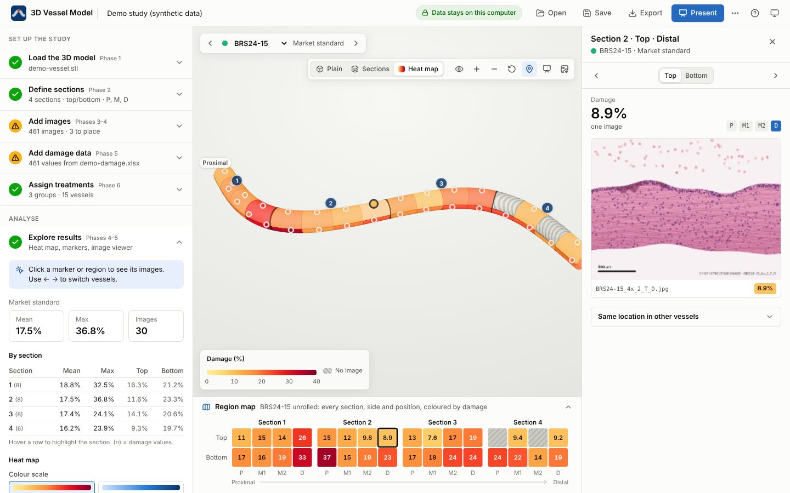
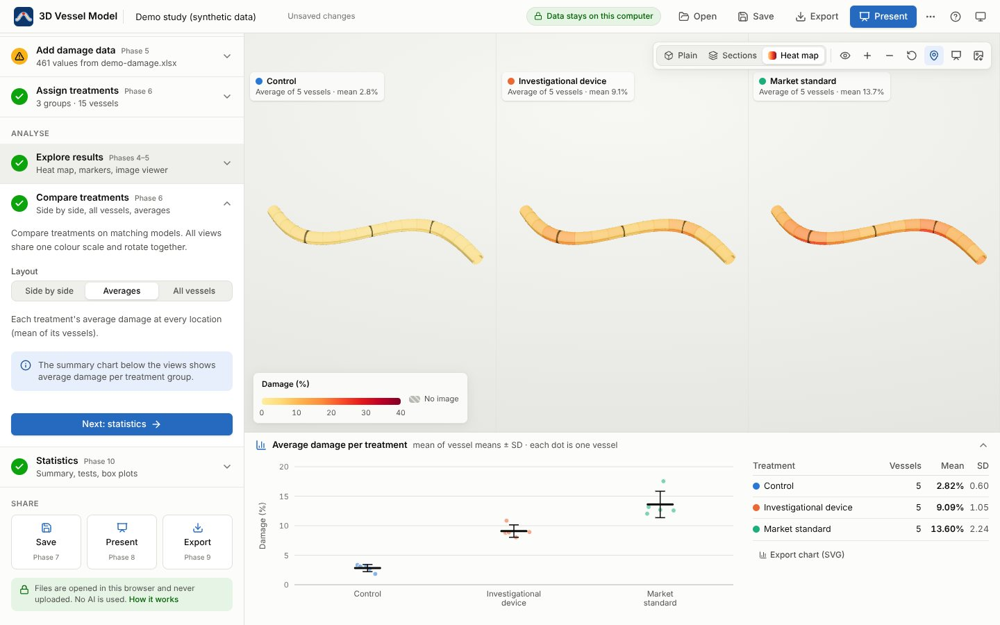
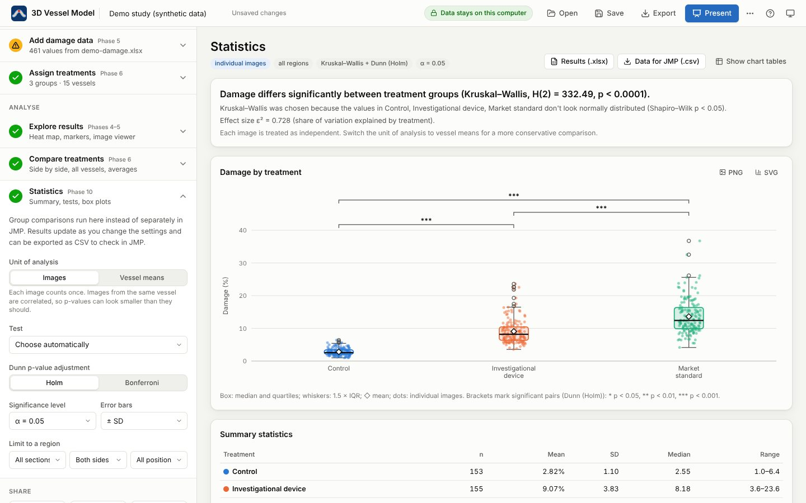
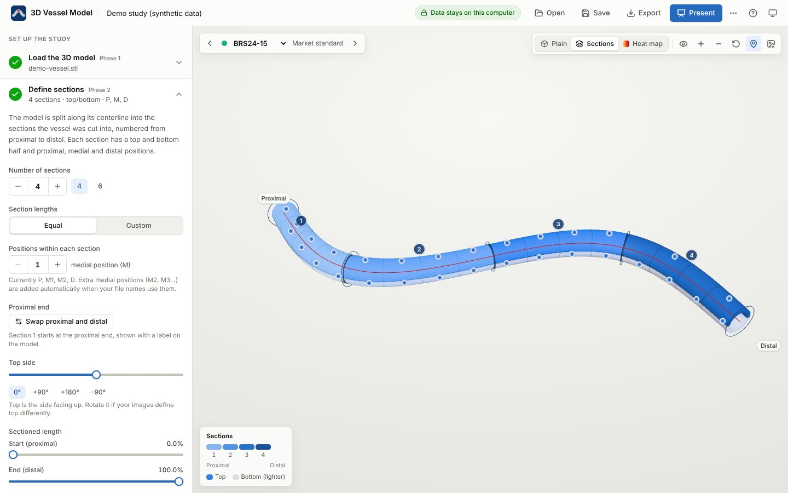
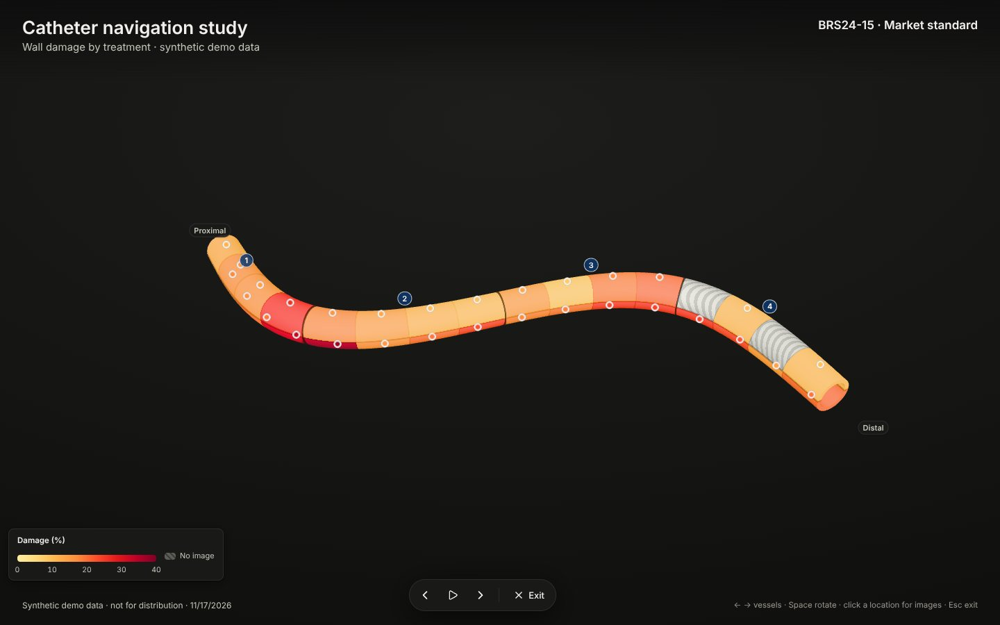

# 3D Vessel Model

An interactive 3D viewer for presenting blood vessel mimic test results to industry partners. Each image of vessel damage is mapped to the place on the vessel where it was taken, and the model is colored as a heat map by damage level. Partners can explore the results on a 3D model instead of paging through folders of images.

**▶ Open the app: <https://aidenedwards406.github.io/3D-vessel-model/>**

Click **Explore the demo study** to try it with synthetic data (15 vessels, 3 treatments, images and damage values), or load your own files. Everything runs in your browser: files are opened on your computer and never uploaded.



## Project goals

1. **View a 3D vessel model in the browser**: rotate, zoom and pan.
2. **Load models from two sources**: a phone 3D scan, or an STL file supplied by the partner company.
3. **Divide the vessel into sections**: the user sets how many sections the vessel was cut into (usually 4 or 6).
4. **Map images automatically**: images are placed on the model by reading our existing file names (section, top/bottom, and position along the section).
5. **Click to inspect**: clicking a location opens the image or set of images taken there.
6. **Damage heat map**: upload the Excel sheet of percent damage per image, and the model is colored by damage level.
7. **Compare treatments**: switch between vessels (bioreactors) to compare controls, the partner's new device, and market-standard devices.
8. **Keep data confidential**: partner data stays on the user's computer and is never uploaded or stored by the app.
9. **Save and reopen studies**: save a study's full setup as one file and reopen it later without setting it up again.
10. **Presentation mode**: a clean, distraction-free view for partner meetings.
11. **Export for submissions**: export heat maps and charts for reports and FDA submissions.

All eleven goals are implemented. See the [roadmap](#roadmap).

## Background

We build blood vessel mimics. Industry partners test their medical devices on our models, for example catheters, to measure:

- **Wall damage**: how much the device damages the vessel wall.
- **Navigation**: how well the device moves through tortuous (twisting) geometry compared with other devices on the market.

A single study can involve many vessels. The most recent one used **25 vessels**, each grown in its own bioreactor and given a different treatment:

- **Control**: no device, or a baseline condition.
- **Investigational device**: the partner's new product, often one going through FDA approval.
- **Market standard**: an existing approved device used for comparison.

After testing, each vessel is cut into sections and imaged, which gives hundreds of images per study. Damage is quantified by tracing the damaged areas in each image and counting the damaged pixels. Results are recorded as **percent damage** per image.

## Image naming convention (existing)

The app reads the file names we already use:

```
BRS24-10_4x_2_T_M2
```

| Part | Meaning | Values |
|---|---|---|
| `BRS24-10` | Bioreactor ID, which identifies the vessel and its treatment | Any ID |
| `4x` | Magnification | Normally `4x` |
| `2` | Section number | Usually 1–4 or 1–6, depending on the geometry |
| `T` | Side of the vessel | `T` = top, `B` = bottom |
| `M2` | Position within the section | `P` = proximal, `M1`, `M2`, … = medial (can be more than one), `D` = distal |

The bioreactor ID doesn't say which treatment was used, so the app also takes a **treatment key**: a small table matching each bioreactor ID to its treatment, for example `BRS24-10 → Control`. This can be a separate sheet or a column in the damage spreadsheet.

Images whose names don't match the format are flagged so they can be placed by hand.

The reader is forgiving: capitals, file extensions (`.tif`, `.ome.tif`, …), spaces instead of underscores, words such as `Top`, `Prox` or `section 2`, and a missing magnification are all accepted. A suffix such as `_2` adds another image at the same spot, and `_trace` or `_mask` marks a traced damage outline that can be shown over the original. When a name can't be read, the app says exactly which part is wrong.

## How it works

### 1. Load the model
- **STL file**: the partner's CAD model, exported from SolidWorks with *File → Save As → STL*.
- **Phone scan**: scan the physical vessel with a phone 3D-scanning app and upload the exported file (`.glb` or `.obj`).

### 2. Define sections
- Enter the number of sections, for example 4 or 6.
- The model is split along its centerline into that many sections, numbered from proximal to distal.
- Each section is divided into top and bottom halves, and into proximal, medial and distal positions along its length.

### 3. Upload images and data
- Upload a study's images all at once. Each image is placed from its file name.
- Upload the **Excel damage sheet**, with image names in one column and percent damage in another.
- Upload or enter the **treatment key**.

The images don't need to cover the whole vessel or overlap. They are pinned to locations, not stitched into one continuous surface.

### 4. Explore
- Markers show where each image was taken.
- Click a marker or section to open its images, each with its percent damage.
- Per-section summaries show average and maximum damage.

### 5. Damage heat map
- The model is colored by percent damage, from low to high, with a color scale legend.
- Locations with no image are shown in neutral gray, so missing data is never mistaken for zero damage.
- The color scale can be fixed across all vessels so colors are comparable between treatments.

### 6. Compare treatments
- Pick a bioreactor or treatment to view.
- Side-by-side view: two treatments on matching models, rotating together.
- Summary chart: average damage per treatment group.

## Using the app

The left-hand panel walks through the study in numbered steps that follow the roadmap phases. Each step shows a ✓ when it's done and a ⚠ when something needs attention. You can drop files anywhere on the page: models, image folders, spreadsheets and saved studies are recognised automatically.

| Step | What you do | Roadmap |
|---|---|---|
| **1 · Load the 3D model** | Drop an STL, GLB, glTF, OBJ (+MTL and textures), PLY, or a `.zip` from a scanning app. Set the units and which axis points up, or use **Lay flat**. | Phase 1 |
| **2 · Define sections** | Number of sections (equal or custom lengths), medial positions, which end is proximal, which side is top, and an optional trimmed length to leave out end fittings. The centerline, cut rings and section numbers are shown on the model. | Phase 2 |
| **3 · Add images** | Drop the whole image folder. TIFF (8/16-bit), JPEG, PNG and BMP are supported. Flagged names get a plain-language reason; place them with a form or by clicking where they were taken on the model. | Phases 3–4 |
| **4 · Add damage data** | Drop the Excel (`.xlsx`) or CSV sheet. The image name, % damage and treatment columns are detected automatically and can be changed, with a preview. Excel percent formats are converted; values that look like fractions are flagged. Download a template pre-filled with your image names. | Phase 5 |
| **5 · Assign treatments** | Upload a treatment key, use the column or sheet in the damage workbook, or assign treatments here. Rename groups, set their role, colour and order. | Phase 6 |
| **6 · Explore results** | Switch vessels with ← →. Hover for values, click a marker or region (or a cell of the unrolled **region map**) to see its images; step along the vessel, flip top/bottom, and see the same location in every other vessel. Open an image full screen to zoom, pan, flip through neighbouring images and show the traced outline. Heat-map settings: palette, fixed or custom range, bands, mean/median/max per location, smooth blending. | Phases 4–5 |
| **7 · Compare treatments** | Side by side (vessels or treatment averages, with an optional difference view), all vessels in a grid, or treatment averages. All views share one colour scale and rotate together. A summary chart shows average damage per treatment. | Phase 6 |
| **8 · Statistics** | Summary statistics, normality and equal-spread checks, ANOVA + Tukey HSD, Welch's ANOVA + Games–Howell or Kruskal–Wallis + Dunn (chosen automatically or by hand), box plots with significance brackets, and breakdowns by section, side and position. Analyse individual images or vessel means, for all regions or one region. | Phase 10 |

**Share** (bottom of the panel and top bar):

- **Save** (Phase 7): one `.vessel` file with the model, sections, placements, damage data, treatment key, colours and presentation scenes, optionally with all images. Opening it restores the study exactly. Without images it stays small, and the images can be relinked from their folder.
- **Present** (Phase 8): full screen, no editing controls, with the study title, company logo, colour legend and a confidentiality footer. Save views as **scenes** and step through them with the arrow keys; Space rotates the model. Scenes adapt to the screen they are shown on.
- **Export** (Phase 9): high-resolution PNGs of the 3D view (up to 4K, white/transparent/dark, with title and legend), every vessel or every treatment average as a ZIP of PNGs, vector **region maps** (SVG), charts (SVG/PNG), a statistics workbook (`.xlsx`), data for JMP (`.csv`), the coloured 3D model (`.glb`, opens in PowerPoint), and a **PDF summary report** with heat maps from the top and bottom, region maps, statistics, charts, every vessel and the data table.

### Statistics

The statistics run in the app instead of separately in JMP, and the results can be exported to check in JMP:

- Summary statistics per treatment group: mean, SD, SEM, 95% CI, median, quartiles, range and number of images (or vessels).
- Comparisons between groups: one-way ANOVA with Tukey HSD; Welch's ANOVA with Games–Howell when spreads differ; Kruskal–Wallis with Dunn's test (Holm or Bonferroni) when the data aren't normally distributed. **Choose automatically** picks the test from Shapiro–Wilk and Brown–Forsythe checks and explains why.
- Breakdowns by section, top/bottom and position.
- Box plots with significance markers, exportable with the other charts.
- Unit of analysis: individual images, or vessel means. Images from one vessel aren't independent, so vessel means give the more conservative comparison.

Every test is checked against SciPy, scikit-posthocs and pingouin in the unit tests (`src/lib/stats/stats.test.ts`, reference values generated by `scripts/make_stats_fixture.py`).

### How the sections are found

STL files and scans don't say where the vessel's centerline is, so the app works it out. It finds the two ends of the vessel from geodesic (along-the-surface) distances, measures rings of equal distance between the two end rims, and joins the centres of those rings into a smooth centerline that follows bends. Every point on the model is then projected onto the centerline, like cutting the vessel with a blade. This works for straight, S-shaped and helical vessels, capped or open ends, and noisy scans with stray fragments. Large scans (millions of triangles) take a few seconds and are processed in the background, so the page stays responsive. For straight tubes or very irregular scans you can switch to a straight axis. "Top" is measured from the up direction, which follows the curve of the vessel.

## Confidentiality

Partner data is often confidential, especially for devices still in FDA review. The app is designed so that data stays private:

- **Processing happens on your computer.** Images, Excel sheets and models are opened in your browser. The app doesn't send them to a server, AI service or anyone else.
- **No AI in the app.** The viewer is ordinary code that reads file names and numbers. It doesn't analyze images with AI or send them to an AI.
- **Data is kept out of the repository.** Only the app code is stored on GitHub. Study images, spreadsheets and partner models are loaded from your computer when you use the app, and never committed. A `.gitignore` file blocks common data file types from being uploaded by accident.
- **Sharing with partners.** Show results in a live meeting, or give each partner only their own data. Avoid public links that contain partner data.

How this is enforced:

- The page ships with a **Content-Security-Policy** that only lets it load its own files and blocks connections to any other site, so the browser itself refuses to send data elsewhere. (Tested: a deliberate request to another site is blocked, and a full session makes no requests to other origins.)
- No analytics, fonts or scripts are loaded from other sites.
- Study data is never written to browser storage. Only the light/dark preference is remembered. Closing the tab clears everything unless you saved a `.vessel` file.
- The GitHub page contains only the app. Your files are never on it, and the demo study is generated synthetically in the browser.
- For extra assurance, run the app on your own computer or private hosting (see below).

## Tools used

| Need | Tool | Why |
|---|---|---|
| 3D viewer | [Three.js](https://threejs.org) + [three-mesh-bvh](https://github.com/gkjohnson/three-mesh-bvh) | The standard library for 3D in a web browser; BVH makes clicking on large scans instant |
| App framework | React with Vite, TypeScript, Tailwind CSS | Simple to build and runs fully in the browser |
| Excel reading | A small built-in `.xlsx`/CSV reader (on [fflate](https://github.com/101arrowz/fflate)) | Reads `.xlsx` directly in the browser. Used instead of the npm SheetJS build, which has known security advisories |
| Image decoding | Browser built-ins + [UTIF.js](https://github.com/photopea/UTIF.js) | Microscopy TIFFs, including 16-bit, with automatic contrast |
| Phone scanning | Polycam, Scaniverse, or KIRI Engine | Free phone apps that export `.glb` / `.obj` |
| Charts | Custom SVG charts | Treatment comparison charts that export as true vector SVG |
| PDF reports | [jsPDF](https://github.com/parallax/jsPDF) | Builds the summary report in the browser |
| Running it | GitHub Pages, locally, or on private hosting | No server: the app is a set of static files |

## Saving, presenting and exporting

- **Save and reopen a study**: save the setup (model, section count, image placements, damage data and treatment key) as one project file on your computer. Opening the file restores the study exactly. It stays on your computer like any other confidential file.
- **Presentation mode**: hides editing controls and shows a clean view with a study title, company logo and color scale legend, ready for partner meetings.
- **Export for reports and submissions**: save high-resolution images of heat maps and charts (PNG, and SVG where possible), plus a PDF summary, for written reports and FDA submissions.

<table>
<tr>
<td width="50%"></td>
<td width="50%"></td>
</tr>
<tr>
<td></td>
<td></td>
</tr>
</table>

## More ideas

- **Statistics**: run the analysis in the app instead of separately in JMP. *(Done: see [Statistics](#statistics).)*
- **Image viewer tools**: zoom into images, flip between neighboring images, and optionally show the traced damage outline over the original. *(Done.)*
- Possible next steps: two-way models (treatment × section), Dunnett's test against the control, navigation (tracking-force) data on the same model, and overlaying several vessels' scans.

## Roadmap

- [x] **Phase 1**: Basic viewer that loads an STL / GLB model and supports rotate and zoom
- [x] **Phase 2**: Split the vessel into a chosen number of sections, with top/bottom and P/M/D regions
- [x] **Phase 3**: Upload images, parse file names, and place markers
- [x] **Phase 4**: Click-to-view image panel
- [x] **Phase 5**: Excel upload and damage heat map
- [x] **Phase 6**: Treatment key and side-by-side comparison
- [x] **Phase 7**: Save/open project files
- [x] **Phase 8**: Presentation mode
- [x] **Phase 9**: Export images, charts and PDF summaries
- [x] **Phase 10**: Statistics

## Running it yourself

The app is a set of static files, so it can run anywhere without a server-side component.

```bash
npm install
npm run dev        # development server at http://localhost:5173
npm test           # unit tests
npm run build      # production build in dist/
npm run preview    # serve the production build locally
```

To use it on private hosting or a lab computer without GitHub, copy the contents of `dist/` to any web server or internal share that serves static files. Building needs Node.js 22.12 or newer (the tests need it too).

### Publishing on GitHub Pages

The workflow in `.github/workflows/deploy.yml` tests and builds every push and pull request, and publishes the `main` branch to GitHub Pages. To turn it on once: in the repository, open **Settings → Pages**, and under **Build and deployment** set **Source** to **GitHub Actions**. After the next push to `main` (or **Actions → Test, build and deploy → Run workflow**), the app is live at <https://aidenedwards406.github.io/3D-vessel-model/>.

## Project structure

```
src/
  App.tsx                 page layout, drag-and-drop routing, shortcuts
  components/             UI: steps panel, 3D viewer overlays, image panel and viewer,
                          region map, charts, statistics, dialogs, presentation mode
  geometry/               centerline and section finding (runs in a Web Worker), STL parsing
  three/                  Three.js engine, heat-map shader, model loaders
  lib/                    naming convention, spreadsheets, statistics, colour scales,
                          study data model, save/open, exports, PDF report, demo study
  state/                  app state, derived data, actions
scripts/make_stats_fixture.py   regenerates SciPy reference values for the statistics tests
docs/                     screenshots (synthetic demo data)
```
